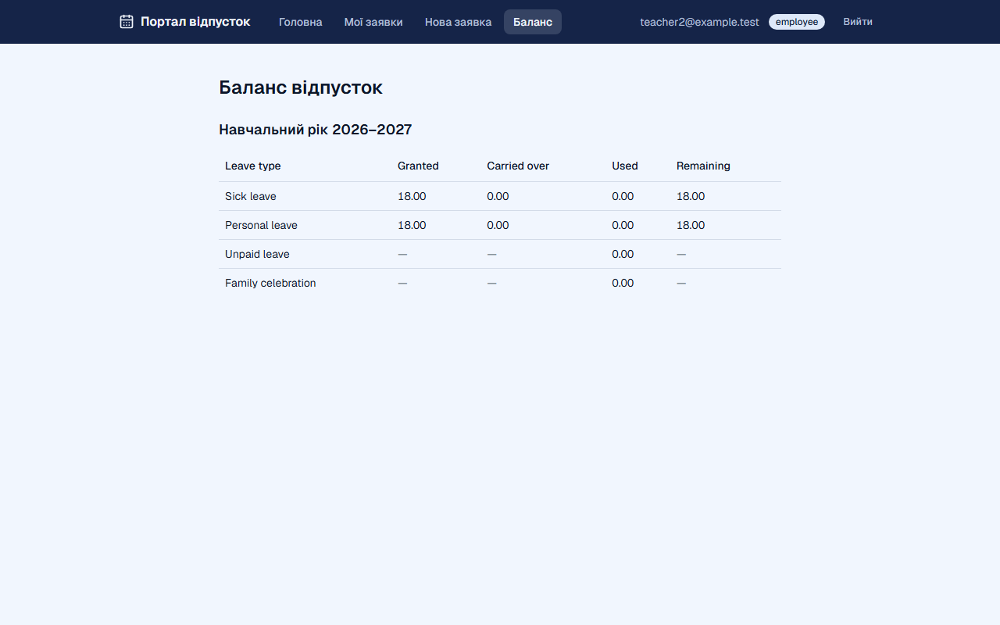
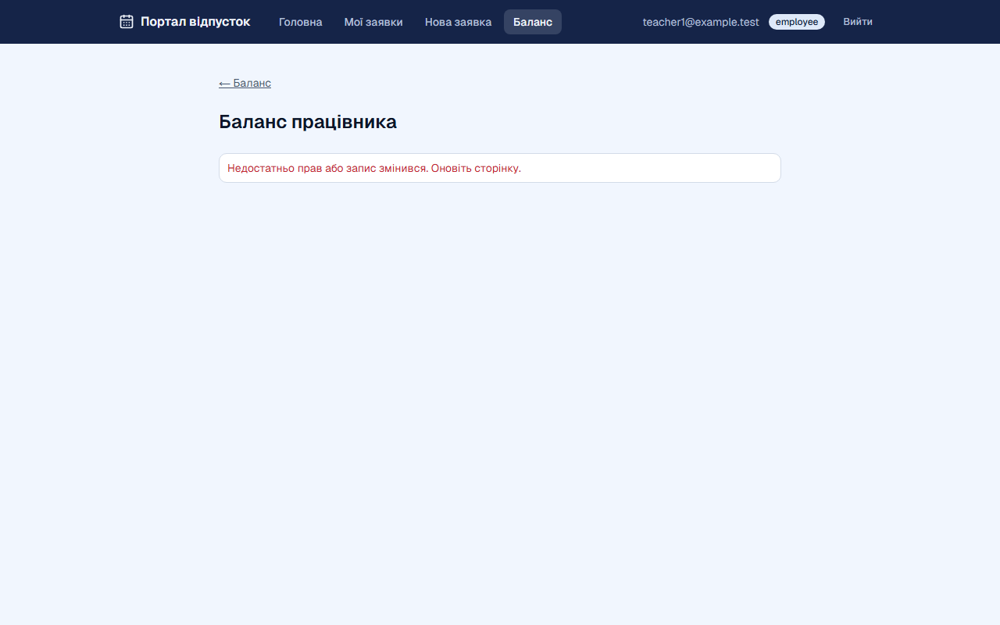
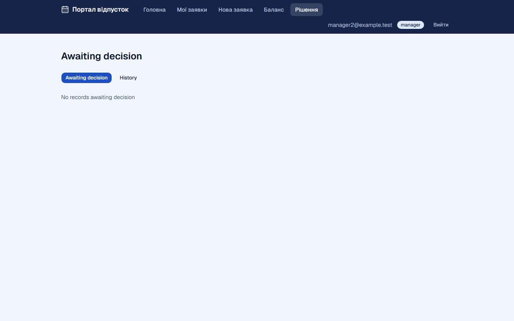

# Звіт UAT — 02.11.2026

- **Застосунок:** https://leave-portal-blush.vercel.app (/api/health: коміт `2336860`)
- **Код тестів:** `task/uat` @ `76cc1cf`
- **Прогін:** 02.11.2026, 13:08 (Київ), Playwright 41.6 с; AC: 3 — PASS 0, FAIL 0, NEEDS-HUMAN 3
- **Рецензент:** `claude-haiku-5-5`; суперечки → `claude-sonnet-5-5`. Разом за розбір: $0.0000 (ціни API; за підпискою — у межах ліміту плану)
- **Прибирання:** не запускалось (прогін без SUPABASE_SECRET_KEY — лише AC, що нічого не пишуть)
- **Відео й траси:** не в git — `test-results/` локально або артефакт CI; трасу відкриває `npx playwright show-trace <trace.zip>`

| AC | Перевірки | Агент | Підсумок | Чому | Playwright | Розбір |
|---|---|---|---|---|---|---|
| AC-BALANCE-01 | пройшли | — | **NEEDS-HUMAN** | R2: немає вердикту агента або кадру | 4.5 с | $0.0000, 0.1 с |
| AC-BALANCE-13 | пройшли | — | **NEEDS-HUMAN** | R2: немає вердикту агента або кадру | 5.8 с | $0.0000, 0.1 с |
| AC-DECIDE-14 | пройшли | — | **NEEDS-HUMAN** | R2: немає вердикту агента або кадру | 3.8 с | $0.0000, 0.0 с |

## AC-BALANCE-01 — NEEDS-HUMAN

**Тест:** AC-BALANCE-01: працівник без погоджених записів і перенесених днів бачить початкові баланси

**Критерій** (requirements/03-leave-balance.md):

> AC-BALANCE-01: Given an employee with no approved records in school year 2026–2027 and no carried-over days. When the employee views their balances. Then the employee sees: "Sick leave" — granted 18.00, used 0.00, remaining 18.00; "Personal leave" — granted 18.00, used 0.00, remaining 18.00; "Unpaid leave" and "Family celebration" — used 0.00 only.

**Кроки:** ✔ Дано: працівник без погоджених записів у навчальному році 2026–2027 і без перенесених днів → ✔ Коли: працівник переглядає свої баланси → ✔ Тоді: "Sick leave" — granted 18.00, used 0.00, remaining 18.00; "Personal leave" — granted 18.00, used 0.00, remaining 18.00; "Unpaid leave" and "Family celebration" — used 0.00 only

**Агент:** вердикту немає

Haiku сказав —, тож розбір повторив Sonnet; рішення агента — за Sonnet.

**Правило:** R2: немає вердикту агента або кадру

**Відео:** `test-results/artifacts/balances-власний-баланс-AC-d238d-ів-бачить-початкові-баланси-chromium/video.webm` · **траса:** `test-results/artifacts/balances-власний-баланс-AC-d238d-ів-бачить-початкові-баланси-chromium/trace.zip` (не в git)

**Рішення PM:** ☐ приймаю · ☐ відхилення від вимог (issue «Відхилення від вимог: AC-BALANCE-01 — …») · @login: ____

## AC-BALANCE-13 — NEEDS-HUMAN

**Тест:** AC-BALANCE-13: працівник не бачить балансів іншого працівника

**Критерій** (requirements/03-leave-balance.md):

> AC-BALANCE-13: Given employee teacher1@example.test. When teacher1@example.test tries to view another employee's balances. Then the balances are not shown.

**Кроки:** ✔ Дано: працівник teacher1@example.test і інший працівник з власним балансом → ✔ Коли: teacher1@example.test намагається переглянути баланси іншого працівника за прямим посиланням → ✔ Тоді: the balances are not shown

**Агент:** вердикту немає

Haiku сказав —, тож розбір повторив Sonnet; рішення агента — за Sonnet.

**Правило:** R2: немає вердикту агента або кадру

**Відео:** `test-results/artifacts/balances-баланс-іншого-пра-3671f--балансів-іншого-працівника-chromium/video.webm` · **траса:** `test-results/artifacts/balances-баланс-іншого-пра-3671f--балансів-іншого-працівника-chromium/trace.zip` (не в git)

**Рішення PM:** ☐ приймаю · ☐ відхилення від вимог (issue «Відхилення від вимог: AC-BALANCE-13 — …») · @login: ____

## AC-DECIDE-14 — NEEDS-HUMAN

**Тест:** AC-DECIDE-14: менеджер без записів, що чекають рішення, бачить повідомлення про порожній список

**Критерій** (requirements/02-leave-decision.md):

> AC-DECIDE-14: Given the manager has 0 records with status "Awaiting decision". When the manager opens the "Awaiting decision" list. Then the manager sees the message "No records awaiting decision".

**Кроки:** ✔ Дано: менеджер має 0 записів зі статусом "Awaiting decision" → ✔ Коли: менеджер відкриває список "Awaiting decision" → ✔ Тоді: the manager sees the message "No records awaiting decision"

**Агент:** вердикту немає

Haiku сказав —, тож розбір повторив Sonnet; рішення агента — за Sonnet.

**Правило:** R2: немає вердикту агента або кадру

**Відео:** `test-results/artifacts/decisions-AC-DECIDE-14-мен-0b851-омлення-про-порожній-список-chromium/video.webm` · **траса:** `test-results/artifacts/decisions-AC-DECIDE-14-мен-0b851-омлення-про-порожній-список-chromium/trace.zip` (не в git)

**Рішення PM:** ☐ приймаю · ☐ відхилення від вимог (issue «Відхилення від вимог: AC-DECIDE-14 — …») · @login: ____

## Як читати підсумок

- **PASS** — автоматичні перевірки пройшли, агент-рецензент погодився з кадром, а кожну його цитату знайдено на сторінці.
- **FAIL** — впала автоматична перевірка. Агент цього не перекриває: невидимі вади (буфер обміну, база) він на кадрі не побачить.
- **NEEDS-HUMAN** — перевірки зелені, але агент не погодився або його цитати немає на сторінці. Часто це слабкий тест або розбіжність між текстом AC і тестом — питання до PM, а не обов'язково вада продукту.

Правила: R1: перевірка впала — FAIL завжди, агент не перекриває; R2: немає вердикту агента або кадру; R3: перевірки пройшли, агент не погоджується — вирішує людина; R4: цитати агента немає на сторінці (aria) — не підтверджено; R5: помилка сторінки або 5xx під час сценарію; R6: перевірки, агент і цитати збігаються.
