# Звіт UAT — 09.11.2026

- **Застосунок:** https://leave-portal-blush.vercel.app (/api/health: коміт `4b1a973`)
- **Код тестів:** `main` @ `4b1a973` + незакомічені зміни
- **Прогін:** 09.11.2026, 13:23 (Київ), Playwright 302.7 с; AC: 19 — PASS 17, FAIL 0, NEEDS-HUMAN 2
- **Рецензент:** `claude-haiku-5-5`; суперечки → `claude-sonnet-5-5`. Разом за розбір: $0.1598 (ціни API; за підпискою — у межах ліміту плану)
- **Прибирання:** синтетичних uat-*@example.test видалено 8, лишилось 0, їхніх рядків, що лишились: 0
- **Відео й траси:** не в git — `test-results/` локально або артефакт CI; трасу відкриває `npx playwright show-trace <trace.zip>`

| AC | Перевірки | Агент | Підсумок | Чому | Playwright | Розбір |
|---|---|---|---|---|---|---|
| AC-BALANCE-01 | пройшли | Haiku: PASS | **PASS** | R6: перевірки, агент і цитати збігаються | 3.2 с | $0.0021, 7.8 с |
| AC-BALANCE-13 | пройшли | Haiku: PASS | **PASS** | R6: перевірки, агент і цитати збігаються | 4.6 с | $0.0018, 7.0 с |
| AC-CAL-01 | пройшли | Haiku: PASS | **PASS** | R6: перевірки, агент і цитати збігаються | 24.8 с | $0.0018, 6.2 с |
| AC-CAL-02 | пройшли | Haiku: PASS | **PASS** | R6: перевірки, агент і цитати збігаються | 14.4 с | $0.0021, 8.6 с |
| AC-CAL-03 | пройшли | Haiku: PASS | **PASS** | R6: перевірки, агент і цитати збігаються | 16.4 с | $0.0017, 6.0 с |
| AC-CAL-04 | пройшли | Haiku: PASS | **PASS** | R6: перевірки, агент і цитати збігаються | 20.6 с | $0.0018, 6.7 с |
| AC-CAL-05 | пройшли | Haiku: PASS, Sonnet: PASS | **NEEDS-HUMAN** | R4: цитати агента немає на сторінці (aria) — не підтверджено | 20.7 с | $0.0405, 17.5 с |
| AC-CAL-06 | пройшли | Haiku: PASS | **PASS** | R6: перевірки, агент і цитати збігаються | 26.9 с | $0.0018, 6.3 с |
| AC-CAL-07 | пройшли | Haiku: PASS | **PASS** | R6: перевірки, агент і цитати збігаються | 9.5 с | $0.0027, 9.9 с |
| AC-CAL-08 | пройшли | Haiku: PASS | **PASS** | R6: перевірки, агент і цитати збігаються | 13.7 с | $0.0019, 7.9 с |
| AC-CAL-09 | пройшли | Haiku: PASS | **PASS** | R6: перевірки, агент і цитати збігаються | 33.6 с | $0.0028, 11.2 с |
| AC-CAL-10 | пройшли | Haiku: PASS | **PASS** | R6: перевірки, агент і цитати збігаються | 19.5 с | $0.0026, 9.9 с |
| AC-CAL-11 | пройшли | Haiku: PASS | **PASS** | R6: перевірки, агент і цитати збігаються | 15.9 с | $0.0018, 7.1 с |
| AC-CAL-12 | пройшли | Haiku: PASS | **PASS** | R6: перевірки, агент і цитати збігаються | 4.6 с | $0.0029, 12.5 с |
| AC-CAL-13 | пройшли | Haiku: NEEDS-HUMAN, Sonnet: NEEDS-HUMAN | **NEEDS-HUMAN** | R3: перевірки пройшли, агент не погоджується — вирішує людина | 13.0 с | $0.0447, 27.0 с |
| AC-CAL-14 | пройшли | Haiku: PASS | **PASS** | R6: перевірки, агент і цитати збігаються | 10.0 с | $0.0020, 8.0 с |
| AC-CAL-15 | пройшли | Haiku: PASS | **PASS** | R6: перевірки, агент і цитати збігаються | 3.8 с | $0.0018, 6.7 с |
| AC-DECIDE-14 | пройшли | Haiku: PASS | **PASS** | R6: перевірки, агент і цитати збігаються | 2.3 с | $0.0018, 6.3 с |
| AC-LEAVE-22 | пройшли | Haiku: NEEDS-HUMAN, Sonnet: PASS | **PASS** | R6: перевірки, агент і цитати збігаються | 16.2 с | $0.0415, 25.6 с |

## AC-BALANCE-01 — PASS

**Тест:** AC-BALANCE-01: працівник без погоджених записів і перенесених днів бачить початкові баланси

**Критерій** (requirements/03-leave-balance.md):

> AC-BALANCE-01: Given an employee with no approved records in school year 2026–2027 and no carried-over days. When the employee views their balances. Then the employee sees: "Sick leave" — granted 18.00, used 0.00, remaining 18.00; "Personal leave" — granted 18.00, used 0.00, remaining 18.00; "Unpaid leave" and "Family celebration" — used 0.00 only.

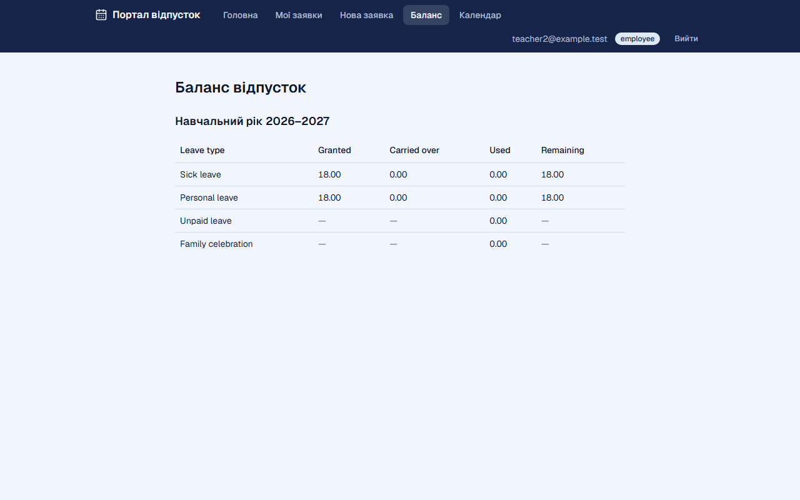

**Кроки:** ✔ Дано: працівник без погоджених записів у навчальному році 2026–2027 і без перенесених днів → ✔ Коли: працівник переглядає свої баланси → ✔ Тоді: "Sick leave" — granted 18.00, used 0.00, remaining 18.00; "Personal leave" — granted 18.00, used 0.00, remaining 18.00; "Unpaid leave" and "Family celebration" — used 0.00 only

**Агент (claude-haiku-5-5, PASS):** На кадрі сторінки «Баланс відпусток» таблиця показує Sick leave і Personal leave з Granted 18.00, Used 0.00, Remaining 18.00 (Carried over 0.00). Unpaid leave і Family celebration мають лише Used 0.00, а решта клітинок містить «—». Заголовок «Навчальний рік 2026–2027» видно на кадрі, але його перевіряють автоматичні тести, тому я його не оцінюю.

**Цитати агента, звірені зі сторінкою (aria):**
- «Sick leave» — є на сторінці
- «18.00» — є на сторінці
- «0.00» — є на сторінці
- «0.00» — є на сторінці
- «18.00» — є на сторінці
- «Personal leave» — є на сторінці
- «18.00» — є на сторінці
- «0.00» — є на сторінці
- «0.00» — є на сторінці
- «18.00» — є на сторінці
- «Unpaid leave» — є на сторінці
- «—» — є на сторінці
- «—» — є на сторінці
- «0.00» — є на сторінці
- «—» — є на сторінці
- «Family celebration» — є на сторінці
- «—» — є на сторінці
- «—» — є на сторінці
- «0.00» — є на сторінці
- «—» — є на сторінці

**Правило:** R6: перевірки, агент і цитати збігаються

**Відео:** `test-results/artifacts/balances-власний-баланс-AC-d238d-ів-бачить-початкові-баланси-chromium/video.webm` · **траса:** `test-results/artifacts/balances-власний-баланс-AC-d238d-ів-бачить-початкові-баланси-chromium/trace.zip` (не в git)

**Рішення PM:** ☐ приймаю · ☐ відхилення від вимог (issue «Відхилення від вимог: AC-BALANCE-01 — …») · @login: ____

## AC-BALANCE-13 — PASS

**Тест:** AC-BALANCE-13: працівник не бачить балансів іншого працівника

**Критерій** (requirements/03-leave-balance.md):

> AC-BALANCE-13: Given employee teacher1@example.test. When teacher1@example.test tries to view another employee's balances. Then the balances are not shown.

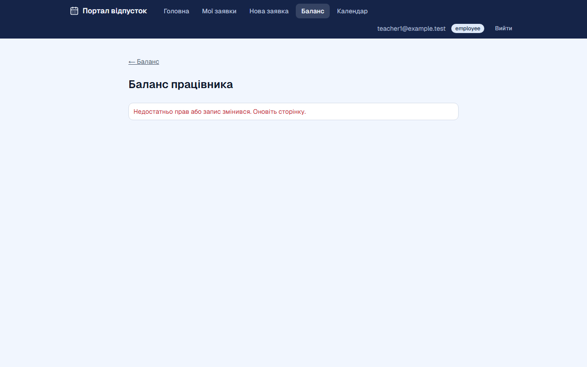

**Кроки:** ✔ Дано: працівник teacher1@example.test і інший працівник з власним балансом → ✔ Коли: teacher1@example.test намагається переглянути баланси іншого працівника за прямим посиланням → ✔ Тоді: the balances are not shown

**Агент (claude-haiku-5-5, PASS):** На кадрі видно сторінку «Баланс працівника» (URL /balances/0e84dd68-…, за критерієм) із червоним повідомленням про відмову: «Недостатньо прав або запис змінився. Оновіть сторінку.» Таблиці балансів під заголовком немає, лише порожня область під повідомленням. Навігація показує користувача teacher1@example.test з роллю employee.

**Цитати агента, звірені зі сторінкою (aria):**
- «Баланс працівника» — є на сторінці
- «Недостатньо прав або запис змінився. Оновіть сторінку.» — є на сторінці
- «Недостатньо прав або запис змінився. Оновіть сторінку.» — є на сторінці

**Правило:** R6: перевірки, агент і цитати збігаються

**Відео:** `test-results/artifacts/balances-баланс-іншого-пра-3671f--балансів-іншого-працівника-chromium/video.webm` · **траса:** `test-results/artifacts/balances-баланс-іншого-пра-3671f--балансів-іншого-працівника-chromium/trace.zip` (не в git)

**Рішення PM:** ☐ приймаю · ☐ відхилення від вимог (issue «Відхилення від вимог: AC-BALANCE-13 — …») · @login: ____

## AC-CAL-01 — PASS

**Тест:** AC-CAL-01: адміністратор додає «Winter break» на цілі дні, і календар показує його з датами

**Критерій** (requirements/04-school-calendar.md):

> AC-CAL-01: Given the school calendar has no closures. When the administrator adds the closure "Winter break" for whole days from 2026-12-28 to 2027-01-08. Then the school calendar shows "Winter break" with the dates 2026-12-28 – 2027-01-08.

**Кроки:** ✔ Дано: шкільний календар не має закриттів → ✔ Коли: адміністратор додає закриття "Winter break" на цілі дні з 2026-12-28 до 2027-01-08 → ✔ Тоді: the school calendar shows "Winter break" with the dates 2026-12-28 – 2027-01-08

**Агент (claude-haiku-5-5, PASS):** На кадрі /calendar видно заголовок «Шкільний календар», перемикач років із написом «2026–2027» і картку з «Winter break» та датами «2026-12-28 – 2027-01-08». Текст читабельний, кадр повний, завантаження немає. Усі три видимі частини «Тоді» підтверджено.

**Цитати агента, звірені зі сторінкою (aria):**
- «Шкільний календар» — є на сторінці
- «2026–2027» — є на сторінці
- «Winter break» — є на сторінці
- «2026-12-28 – 2027-01-08» — є на сторінці

**Правило:** R6: перевірки, агент і цитати збігаються

**Відео:** `test-results/artifacts/calendar-адміністратор-AC--5d031-ендар-показує-його-з-датами-chromium/video.webm` · **траса:** `test-results/artifacts/calendar-адміністратор-AC--5d031-ендар-показує-його-з-датами-chromium/trace.zip` (не в git)

**Рішення PM:** ☐ приймаю · ☐ відхилення від вимог (issue «Відхилення від вимог: AC-CAL-01 — …») · @login: ____

## AC-CAL-02 — PASS

**Тест:** AC-CAL-02: teacher1 бачить «Winter break» з датами

**Критерій** (requirements/04-school-calendar.md):

> AC-CAL-02: Given the administrator added "Winter break" 2026-12-28 – 2027-01-08. When teacher1@example.test opens the school calendar. Then teacher1@example.test sees "Winter break" with the dates 2026-12-28 – 2027-01-08.

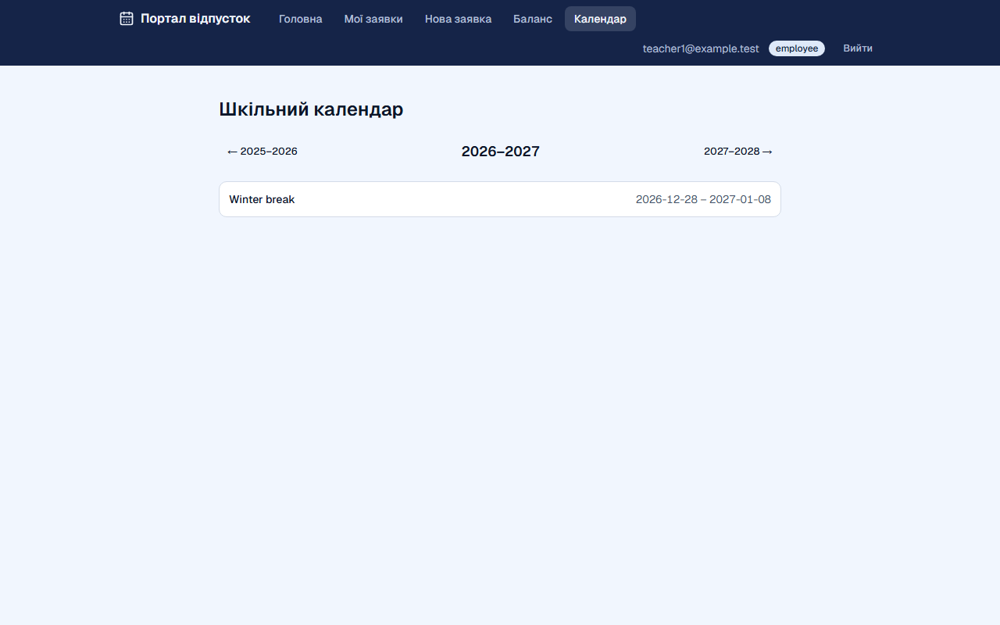

**Кроки:** ✔ Дано: адміністратор додав "Winter break" 2026-12-28 – 2027-01-08 → ✔ Коли: teacher1@example.test відкриває шкільний календар → ✔ Тоді: teacher1@example.test sees "Winter break" with the dates 2026-12-28 – 2027-01-08

**Агент (claude-haiku-5-5, PASS):** На кадрі frame-then-1.png (сторінка /calendar, користувач teacher1@example.test у навігації) видно заголовок «Шкільний календар», перемикач років із написом 2026–2027 і картку «Winter break» з датами 2026-12-28 – 2027-01-08. Тире в даті виглядає як en dash з пробілами, як у критерії; за роздільністю кадру це підтверджено візуально, але символ тире не перевіряв побайтово.

**Цитати агента, звірені зі сторінкою (aria):**
- «Шкільний календар» — є на сторінці
- «2026–2027» — є на сторінці
- «Winter break» — є на сторінці
- «2026-12-28 – 2027-01-08» — є на сторінці

**Правило:** R6: перевірки, агент і цитати збігаються

**Відео:** `test-results/artifacts/calendar-працівник-і-кален-f86a3-ить-«Winter-break»-з-датами-chromium/video.webm` · **траса:** `test-results/artifacts/calendar-працівник-і-кален-f86a3-ить-«Winter-break»-з-датами-chromium/trace.zip` (не в git)

**Рішення PM:** ☐ приймаю · ☐ відхилення від вимог (issue «Відхилення від вимог: AC-CAL-02 — …») · @login: ____

## AC-CAL-03 — PASS

**Тест:** AC-CAL-03: закритий день не приймається в новій заявці

**Критерій** (requirements/04-school-calendar.md):

> AC-CAL-03: Given "Winter break" 2026-12-28 – 2027-01-08 and an employee with the schedule Mon–Fri 08:30–15:30. When the employee tries to choose Tuesday 2026-12-29 in a new request. Then the date is not accepted, and the employee sees the message "The school is closed on this day: Winter break".

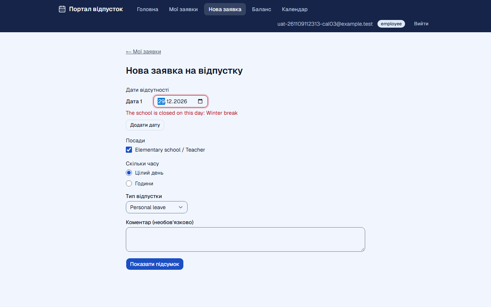

**Кроки:** ✔ Дано: "Winter break" 2026-12-28 – 2027-01-08 і працівник із розкладом Mon–Fri 08:30–15:30 → ✔ Коли: працівник намагається обрати вівторок 2026-12-29 у новій заявці → ✔ Тоді: the employee sees the message "The school is closed on this day: Winter break"

**Агент (claude-haiku-5-5, PASS):** На кадрі сторінка «Нова заявка на відпустку» з полем «Дата 1», у якому видно 29.12.2026, а під полем червоним текстом написано «The school is closed on this day: Winter break», що посимвольно збігається з критерієм. Частина «дата не прийнята, підсумок не створено» не з кадрів і не оцінювалась.

**Цитати агента, звірені зі сторінкою (aria):**
- «Нова заявка на відпустку» — є на сторінці
- «The school is closed on this day: Winter break» — є на сторінці

**Правило:** R6: перевірки, агент і цитати збігаються

**Відео:** `test-results/artifacts/calendar-працівник-і-кален-77807--приймається-в-новій-заявці-chromium/video.webm` · **траса:** `test-results/artifacts/calendar-працівник-і-кален-77807--приймається-в-новій-заявці-chromium/trace.zip` (не в git)

**Рішення PM:** ☐ приймаю · ☐ відхилення від вимог (issue «Відхилення від вимог: AC-CAL-03 — …») · @login: ____

## AC-CAL-04 — PASS

**Тест:** AC-CAL-04: на скороченому дні заявка на цілий день створює 1 запис 08:30–12:00

**Критерій** (requirements/04-school-calendar.md):

> AC-CAL-04: Given an early dismissal "Teachers' meeting" on Friday 2026-11-20 from 12:00 and an employee with the schedule Mon–Fri 08:30–15:30. When the employee requests "Personal leave" for the whole day 2026-11-20 and confirms the summary. Then 1 record 2026-11-20 08:30–12:00 is created.

**Кроки:** ✔ Дано: скорочений день "Teachers' meeting" у п'ятницю 2026-11-20 від 12:00 і працівник із розкладом Mon–Fri 08:30–15:30 → ✔ Коли: працівник просить "Personal leave" на цілий день 2026-11-20 і підтверджує підсумок → ✔ Тоді: 1 record 2026-11-20 08:30–12:00 is created

**Агент (claude-haiku-5-5, PASS):** На кадрі сторінки /leave видно заголовок «My requests» і рівно один рядок заявки: дата 2026-11-20, години 08:30–12:00, тип Personal leave (статус «Awaiting decision»). Таблиця містить лише цей один запис, тож створено одну заявку з потрібним інтервалом. Статус і посада в рядку не входять до критерію і не оцінювались.

**Цитати агента, звірені зі сторінкою (aria):**
- «My requests» — є на сторінці
- «2026-11-20» — є на сторінці
- «08:30–12:00» — є на сторінці
- «Personal leave» — є на сторінці

**Правило:** R6: перевірки, агент і цитати збігаються

**Відео:** `test-results/artifacts/calendar-працівник-і-кален-4b0ce-створює-1-запис-08-30–12-00-chromium/video.webm` · **траса:** `test-results/artifacts/calendar-працівник-і-кален-4b0ce-створює-1-запис-08-30–12-00-chromium/trace.zip` (не в git)

**Рішення PM:** ☐ приймаю · ☐ відхилення від вимог (issue «Відхилення від вимог: AC-CAL-04 — …») · @login: ____

## AC-CAL-05 — NEEDS-HUMAN

**Тест:** AC-CAL-05: години після закриття не створюють заявки, працівник бачить повідомлення

**Критерій** (requirements/04-school-calendar.md):

> AC-CAL-05: Given the early dismissal from AC-CAL-04 and the same employee. When the employee enters the hours 13:00–14:00 on 2026-11-20. Then no request is created, and the employee sees the message "Hours must be within your schedule: 08:30–12:00".

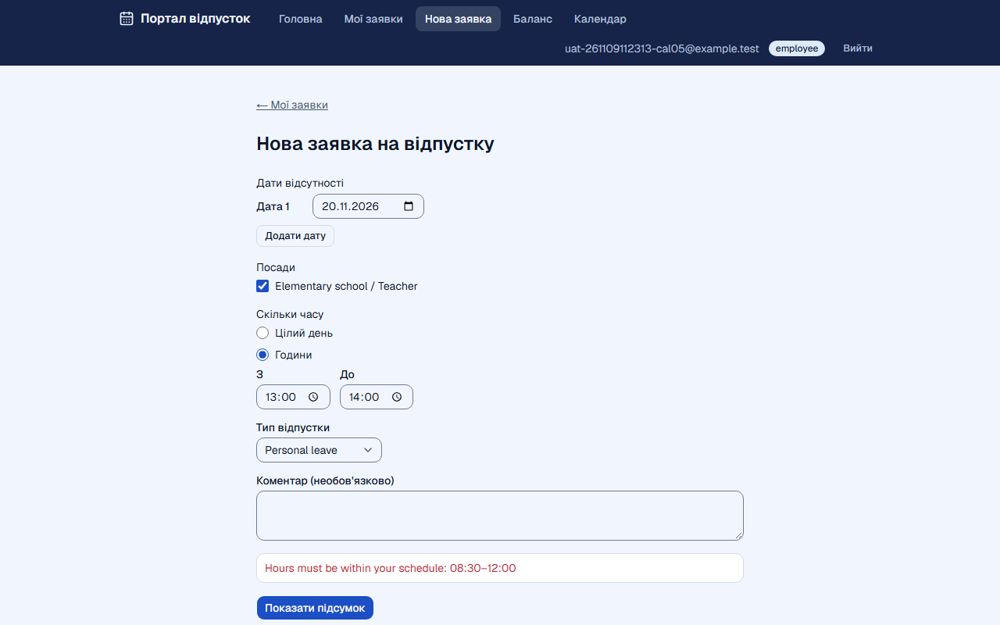
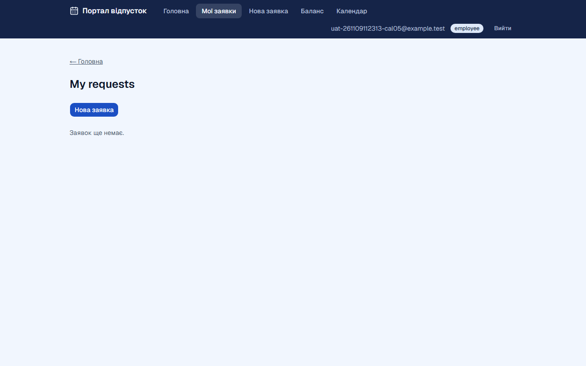

**Кроки:** ✔ Дано: скорочений день з AC-CAL-04 і той самий працівник → ✔ Коли: працівник вводить години 13:00–14:00 на 2026-11-20 → ✔ Тоді: the employee sees the message "Hours must be within your schedule: 08:30–12:00" → ✔ Тоді: no request is created

**Агент (claude-sonnet-5-5, PASS):** На першому кадрі форма «Нова заявка на відпустку» має години З 13:00 До 14:00 на даті 20.11.2026 і червоне повідомлення «Hours must be within your schedule: 08:30–12:00». На другому кадрі сторінка «My requests» показує «Заявок ще немає.», тобто заявку не створено.

Haiku сказав PASS, тож розбір повторив Sonnet; рішення агента — за Sonnet.

**Цитати агента, звірені зі сторінкою (aria):**
- «Нова заявка на відпустку» — є на сторінці
- «Годин��» — НЕМАЄ на сторінці
- «З» — є на сторінці
- «13:00» — є на сторінці
- «До» — є на сторінці
- «14:00» — є на сторінці
- «Hours must be within your schedule: 08:30–12:00» — є на сторінці
- «My requests» — є на сторінці
- «Заявок ще немає.» — є на сторінці

**Правило:** R4: цитати агента немає на сторінці (aria) — не підтверджено

**Відео:** `test-results/artifacts/calendar-працівник-і-кален-3447f-ацівник-бачить-повідомлення-chromium/video.webm` · **траса:** `test-results/artifacts/calendar-працівник-і-кален-3447f-ацівник-бачить-повідомлення-chromium/trace.zip` (не в git)

**Рішення PM:** ☐ приймаю · ☐ відхилення від вимог (issue «Відхилення від вимог: AC-CAL-05 — …») · @login: ____

## AC-CAL-06 — PASS

**Тест:** AC-CAL-06: схвалення запису на скороченому дні дає «Sick leave» використано 1.00, а не 0.50

**Критерій** (requirements/04-school-calendar.md):

> AC-CAL-06: Given the early dismissal from AC-CAL-04, an employee with a single position (schedule Fri 08:30–15:30) and "Sick leave" used 0.00. When the manager approves the whole-day "Sick leave" record 2026-11-20 08:30–12:00. Then the employee's balances show "Sick leave" used 1.00 (210 of 210 working minutes that day), not 0.50.

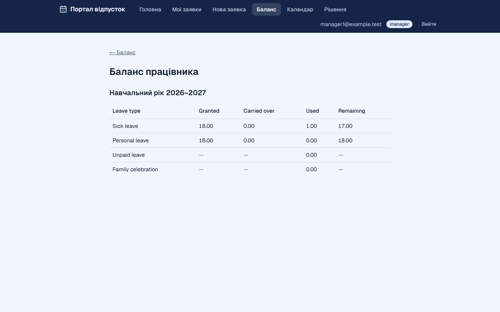

**Кроки:** ✔ Дано: скорочений день з AC-CAL-04, працівник з однією посадою (розклад Fri 08:30–15:30) і «Sick leave» використано 0.00 → ✔ Коли: менеджер схвалює запис "Sick leave" на цілий день 2026-11-20 08:30–12:00 → ✔ Тоді: the employee's balances show "Sick leave" used 1.00 (210 of 210 working minutes that day), not 0.50

**Агент (claude-haiku-5-5, PASS):** На кадрі сторінка «Баланс працівника» (2026–2027), у рядку «Sick leave» стовпець Used показує 1.00, Remaining — 17.00 (Granted 18.00, Carried over 0.00). Значення 0.50 немає, тож вимога «1.00, не 0.50» видима. Фраза про 210 з 210 робочих хвилин на кадрі не відображена, але в переліку видимих частин її немає.

**Цитати агента, звірені зі сторінкою (aria):**
- «Баланс працівника» — є на сторінці
- «Sick leave» — є на сторінці
- «1.00» — є на сторінці
- «17.00» — є на сторінці

**Правило:** R6: перевірки, агент і цитати збігаються

**Відео:** `test-results/artifacts/calendar-баланс-на-скороче-2cc02--використано-1-00-а-не-0-50-chromium/video.webm` · **траса:** `test-results/artifacts/calendar-баланс-на-скороче-2cc02--використано-1-00-а-не-0-50-chromium/trace.zip` (не в git)

**Рішення PM:** ☐ приймаю · ☐ відхилення від вимог (issue «Відхилення від вимог: AC-CAL-06 — …») · @login: ____

## AC-CAL-07 — PASS

**Тест:** AC-CAL-07: погоджений запис teacher1 блокує закриття, і адміністратор бачить перелік записів

**Критерій** (requirements/04-school-calendar.md):

> AC-CAL-07: Given teacher1@example.test has a record 2026-12-29 08:30–15:30 with status "Approved". When the administrator tries to add "Winter break" from 2026-12-28 to 2027-01-08. Then the closure is not saved, the school calendar has no "Winter break", and the administrator sees the message "These days have leave records and cannot be closed: 2026-12-29 teacher1@example.test".

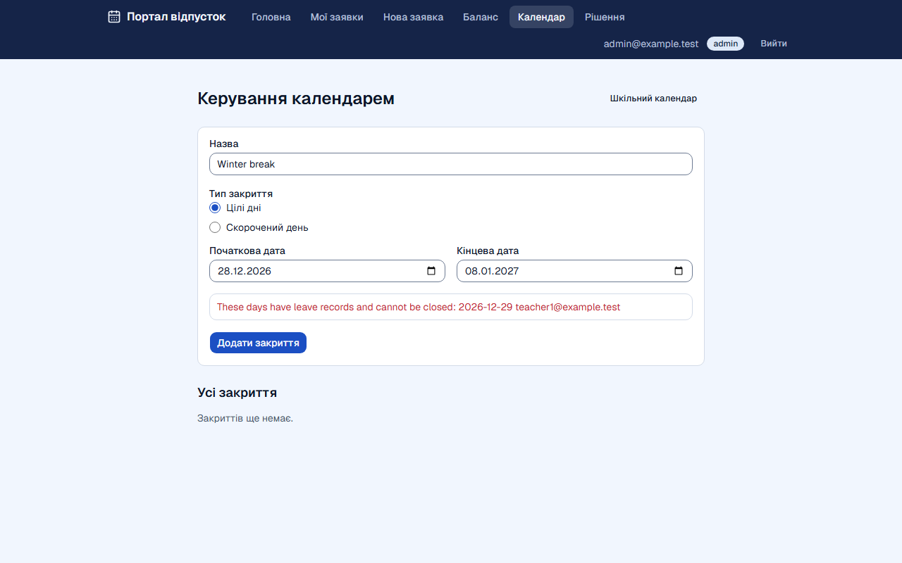

**Кроки:** ✔ Дано: teacher1@example.test має запис 2026-12-29 08:30–15:30 зі статусом "Approved" → ✔ Коли: адміністратор намагається додати "Winter break" з 2026-12-28 до 2027-01-08 → ✔ Тоді: the administrator sees the message "These days have leave records and cannot be closed: 2026-12-29 teacher1@example.test" → ✔ Тоді: the closure is not saved, the school calendar has no "Winter break"

**Агент (claude-haiku-5-5, PASS):** На frame-then-1.png (/calendar/manage) видно червоне повідомлення з текстом, що збігається з критерієм, а форма містить "Winter break" з датами 28.12.2026–08.01.2027, та список «Усі закриття» з написом «Закриттів ще немає». На frame-then-2.png (/calendar) видно «Шкільний календар», «2026–2027» і «No closed days in school year 2026–2027», тобто закриття не збережено. Тире в «2026–2027» на кадрі виглядає як довге (en dash), як у критерії; це єдине місце, де посимвольну відповідність визначаю за виглядом, але візуально збіг.

**Цитати агента, звірені зі сторінкою (aria):**
- «Керування календарем» — є на сторінці
- «Назва» — є на сторінці
- «Winter break» — є на сторінці
- «Тип закриття» — є на сторінці
- «Початкова дата» — є на сторінці
- «Кінцева дата» — є на сторінці
- «These days have leave records and cannot be closed: 2026-12-29 teacher1@example.test» — є на сторінці
- «Шкільний календар» — є на сторінці
- «2026–2027» — є на сторінці
- «No closed days in school year 2026–2027» — є на сторінці
- «No closed days in school year 2026–2027» — є на сторінці

**Правило:** R6: перевірки, агент і цитати збігаються

**Відео:** `test-results/artifacts/calendar-адміністратор-AC--66497-атор-бачить-перелік-записів-chromium/video.webm` · **траса:** `test-results/artifacts/calendar-адміністратор-AC--66497-атор-бачить-перелік-записів-chromium/trace.zip` (не в git)

**Рішення PM:** ☐ приймаю · ☐ відхилення від вимог (issue «Відхилення від вимог: AC-CAL-07 — …») · @login: ____

## AC-CAL-08 — PASS

**Тест:** AC-CAL-08: відхилений запис не блокує закриття, і календар показує «Winter break»

**Критерій** (requirements/04-school-calendar.md):

> AC-CAL-08: Given the only record on 2026-12-29 has status "Rejected". When the administrator adds "Winter break" from 2026-12-28 to 2027-01-08. Then the closure is saved, and the school calendar shows "Winter break" with the dates 2026-12-28 – 2027-01-08.

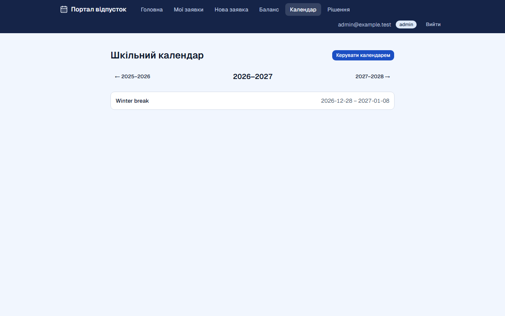

**Кроки:** ✔ Дано: єдиний запис на 2026-12-29 має статус "Rejected" → ✔ Коли: адміністратор додає "Winter break" з 2026-12-28 до 2027-01-08 → ✔ Тоді: the school calendar shows "Winter break" with the dates 2026-12-28 – 2027-01-08

**Агент (claude-haiku-5-5, PASS):** На кадрі сторінки /calendar видно заголовок «Шкільний календар», період «2026–2027» і рядок «Winter break» з датами «2026-12-28 – 2027-01-08». Розділ «Тоді» про збереження закриття не з кадрів, тому не оцінювався. Тире в даті на кадрі виглядає як довге («–»), як і в критерії; посимвольне збігання оцінено за візуальним виглядом, тож при сумніві щодо типу тире варто звірити текст у DOM.

**Цитати агента, звірені зі сторінкою (aria):**
- «Шкільний календар» — є на сторінці
- «2026–2027» — є на сторінці
- «Winter break» — є на сторінці
- «2026-12-28 – 2027-01-08» — є на сторінці

**Правило:** R6: перевірки, агент і цитати збігаються

**Відео:** `test-results/artifacts/calendar-адміністратор-AC--c04a7-ндар-показує-«Winter-break»-chromium/video.webm` · **траса:** `test-results/artifacts/calendar-адміністратор-AC--c04a7-ндар-показує-«Winter-break»-chromium/trace.zip` (не в git)

**Рішення PM:** ☐ приймаю · ☐ відхилення від вимог (issue «Відхилення від вимог: AC-CAL-08 — …») · @login: ____

## AC-CAL-09 — PASS

**Тест:** AC-CAL-09: після видалення «Winter break» календар його не показує, а 2026-12-29 приймається з годинами 08:30–15:30

**Критерій** (requirements/04-school-calendar.md):

> AC-CAL-09: Given "Winter break" 2026-12-28 – 2027-01-08 and an employee with the schedule Mon–Fri 08:30–15:30. When the administrator removes "Winter break" and the employee then chooses Tuesday 2026-12-29 in a new request. Then the school calendar no longer shows "Winter break", and 2026-12-29 is accepted with the hours 08:30–15:30.

**Кроки:** ✔ Дано: "Winter break" 2026-12-28 – 2027-01-08 і працівник із розкладом Mon–Fri 08:30–15:30 → ✔ Коли: адміністратор видаляє "Winter break", а працівник потім обирає вівторок 2026-12-29 у новій заявці → ✔ Тоді: the school calendar no longer shows "Winter break" → ✔ Тоді: 2026-12-29 is accepted with the hours 08:30–15:30

**Агент (claude-haiku-5-5, PASS):** На кадрі календаря (frame-then-1.png) немає «Winter break»; видно заголовок «Шкільний календар», рік «2026–2027» і напис «No closed days in school year 2026–2027». На кадрі заявки (frame-then-2.png) у «Підсумку» є рядок «2026-12-29, 08:30–15:30 (7 h), Elementary school / Teacher: Awaiting decision», повідомлення про закриту школу не видно. Заголовок у кадрі написано з великої літери («Шкільний»), а в переліку — з малої; це опис частини, а не дослівна цитата, тому зараховано як met.

**Цитати агента, звірені зі сторінкою (aria):**
- «Шкільний календар» — є на сторінці
- «2026–2027» — є на сторінці
- «No closed days in school year 2026–2027» — є на сторінці
- «Підсумок» — є на сторінці
- «2026-12-29, 08:30–15:30 (7 h), Elementary school / Teacher: Awaiting decision» — є на сторінці

**Правило:** R6: перевірки, агент і цитати збігаються

**Відео:** `test-results/artifacts/calendar-адміністратор-AC--3f21c-ться-з-годинами-08-30–15-30-chromium/video.webm` · **траса:** `test-results/artifacts/calendar-адміністратор-AC--3f21c-ться-з-годинами-08-30–15-30-chromium/trace.zip` (не в git)

**Рішення PM:** ☐ приймаю · ☐ відхилення від вимог (issue «Відхилення від вимог: AC-CAL-09 — …») · @login: ____

## AC-CAL-10 — PASS

**Тест:** AC-CAL-10: кінцева дата раніше за початкову не зберігається, і адміністратор бачить повідомлення

**Критерій** (requirements/04-school-calendar.md):

> AC-CAL-10: Given the administrator adds a closure. When the administrator enters the start date 2027-01-08 and the end date 2026-12-28. Then the closure is not saved, and the administrator sees the message "The end date cannot be earlier than the start date".

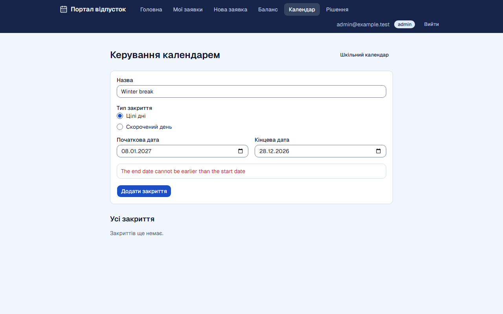
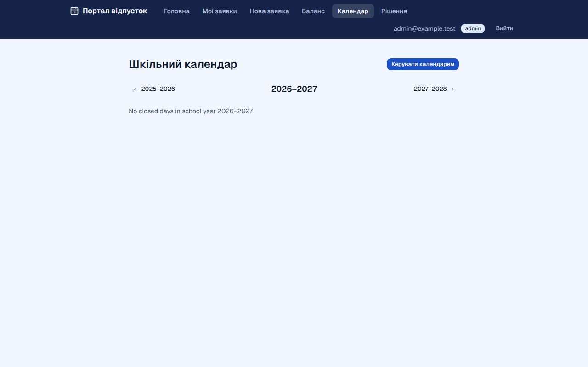

**Кроки:** ✔ Дано: адміністратор додає закриття → ✔ Коли: адміністратор вводить початкову дату 2027-01-08 і кінцеву дату 2026-12-28 → ✔ Тоді: the administrator sees the message "The end date cannot be earlier than the start date" → ✔ Тоді: the closure is not saved

**Агент (claude-haiku-5-5, PASS):** На frame-then-1 видно червоне повідомлення «The end date cannot be earlier than the start date» і блок «Усі закриття» з написом «Закриттів ще немає.», тож закриття не додано. На frame-then-2 видно сторінку «Шкільний календар» із «2026–2027» і написом «No closed days in school year 2026–2027». URL на кадрах не видно, тому що сторінка /calendar, спираюся на заголовок. Частину про форму з назвою та датами не оцінюю, бо це не з кадрів.

**Цитати агента, звірені зі сторінкою (aria):**
- «The end date cannot be earlier than the start date» — є на сторінці
- «Усі закриття» — є на сторінці
- «Закриттів ще немає.» — є на сторінці
- «Шкільний календар» — є на сторінці
- «2026–2027» — є на сторінці
- «No closed days in school year 2026–2027» — є на сторінці

**Правило:** R6: перевірки, агент і цитати збігаються

**Відео:** `test-results/artifacts/calendar-адміністратор-AC--86fd0-стратор-бачить-повідомлення-chromium/video.webm` · **траса:** `test-results/artifacts/calendar-адміністратор-AC--86fd0-стратор-бачить-повідомлення-chromium/trace.zip` (не в git)

**Рішення PM:** ☐ приймаю · ☐ відхилення від вимог (issue «Відхилення від вимог: AC-CAL-10 — …») · @login: ____

## AC-CAL-11 — PASS

**Тест:** AC-CAL-11: закриття «Staff day» на 2026-12-30 не зберігається, бо дата вже закрита

**Критерій** (requirements/04-school-calendar.md):

> AC-CAL-11: Given "Winter break" 2026-12-28 – 2027-01-08. When the administrator tries to add the closure "Staff day" for 2026-12-30. Then the closure is not saved, and the administrator sees the message "2026-12-30 is already closed: Winter break".

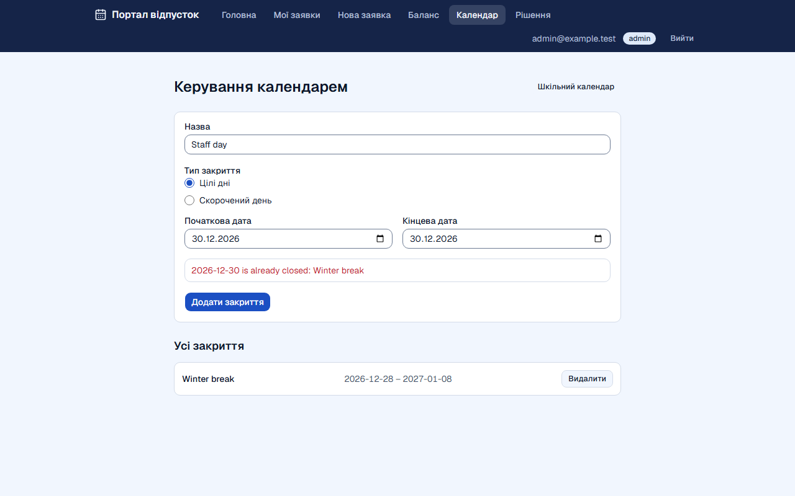

**Кроки:** ✔ Дано: "Winter break" 2026-12-28 – 2027-01-08 → ✔ Коли: адміністратор намагається додати закриття "Staff day" на 2026-12-30 → ✔ Тоді: the administrator sees the message "2026-12-30 is already closed: Winter break"

**Агент (claude-haiku-5-5, PASS):** На кадрі сторінки /calendar/manage червоним кольором видно повідомлення «2026-12-30 is already closed: Winter break», текст збігається з критерієм посимвольно. У блоці «Усі закриття» є лише один запис «Winter break» (2026-12-28 – 2027-01-08), запису «Staff day» немає. Частини «не з кадрів» (збереження в базі, стан форми) не оцінював.

**Цитати агента, звірені зі сторінкою (aria):**
- «2026-12-30 is already closed: Winter break» — є на сторінці
- «Усі закриття» — є на сторінці
- «Winter break» — є на сторінці
- «2026-12-28 – 2027-01-08» — є на сторінці

**Правило:** R6: перевірки, агент і цитати збігаються

**Відео:** `test-results/artifacts/calendar-адміністратор-AC--1ca51-гається-бо-дата-вже-закрита-chromium/video.webm` · **траса:** `test-results/artifacts/calendar-адміністратор-AC--1ca51-гається-бо-дата-вже-закрита-chromium/trace.zip` (не в git)

**Рішення PM:** ☐ приймаю · ☐ відхилення від вимог (issue «Відхилення від вимог: AC-CAL-11 — …») · @login: ____

## AC-CAL-12 — PASS

**Тест:** AC-CAL-12: працівник за прямим посиланням бачить, що календар змінює лише адміністратор

**Критерій** (requirements/04-school-calendar.md):

> AC-CAL-12: Given teacher1@example.test is signed in and has only the employee role. When teacher1@example.test opens the page for changing the school calendar by a direct link. Then teacher1@example.test sees the message "Only an administrator can change the school calendar", and the school calendar is unchanged.

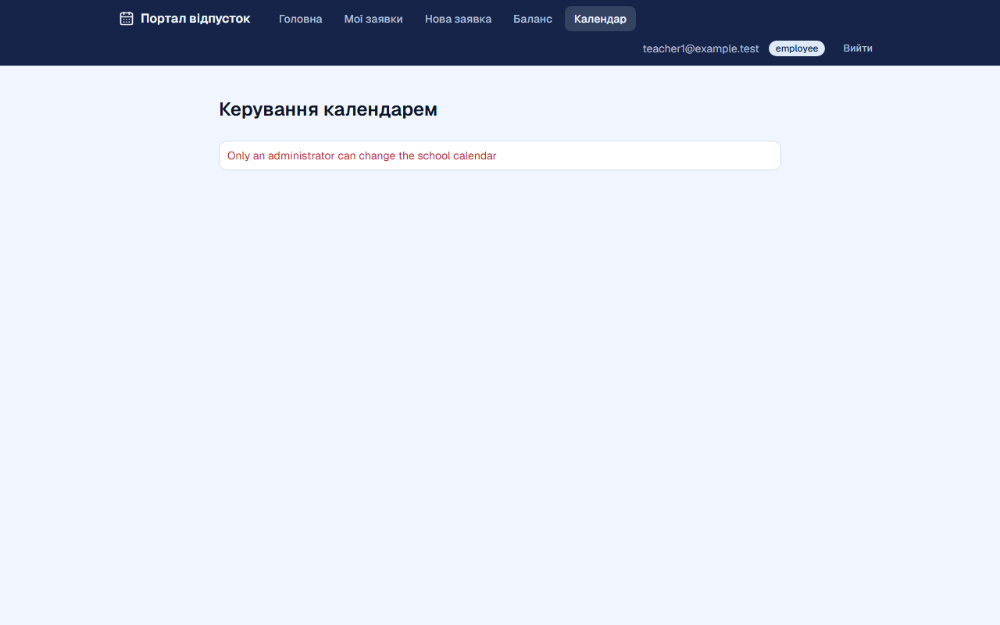

**Кроки:** ✔ Дано: teacher1@example.test увійшов і має лише роль employee → ✔ Коли: teacher1@example.test відкриває сторінку зміни шкільного календаря за прямим посиланням → ✔ Тоді: teacher1@example.test sees the message "Only an administrator can change the school calendar" → ✔ Тоді: the school calendar is unchanged

**Агент (claude-haiku-5-5, PASS):** На frame-then-1.png сторінка «Керування календарем» показує лише червоне повідомлення «Only an administrator can change the school calendar»; форми додавання закриття на кадрі немає, тож видима частина виконана. На frame-then-2.png (/calendar, 2026–2027) напис «No closed days in school year 2026–2027» збігається посимвольно з критерієм, але цей кадр з іншої сторінки і journey.md не фіксує перехід на /calendar, тому з кадрів не видно, що календар саме «unchanged»; це не оцінювалось окремо. Частину «у розмітці немає форми» не оцінюю за правилом 3.

**Цитати агента, звірені зі сторінкою (aria):**
- «Керування календарем» — є на сторінці
- «Only an administrator can change the school calendar» — є на сторінці
- «Керування календарем» — є на сторінці
- «Only an administrator can change the school calendar» — є на сторінці
- «Шкільний календар» — є на сторінці
- «2026–2027» — є на сторінці
- «No closed days in school year 2026–2027» — є на сторінці

**Правило:** R6: перевірки, агент і цитати збігаються

**Відео:** `test-results/artifacts/calendar-працівник-і-кален-9e03c-р-змінює-лише-адміністратор-chromium/video.webm` · **траса:** `test-results/artifacts/calendar-працівник-і-кален-9e03c-р-змінює-лише-адміністратор-chromium/trace.zip` (не в git)

**Рішення PM:** ☐ приймаю · ☐ відхилення від вимог (issue «Відхилення від вимог: AC-CAL-12 — …») · @login: ____

## AC-CAL-13 — NEEDS-HUMAN

**Тест:** AC-CAL-13: менеджер не може закрити день напряму, календар не змінюється, 2026-11-27 приймається

**Критерій** (requirements/04-school-calendar.md):

> AC-CAL-13: Given manager1@example.test is signed in and is not an administrator. When manager1@example.test tries to close 2026-11-27 directly, bypassing the portal's pages. Then the school calendar is unchanged, and 2026-11-27 is still accepted in a new request.

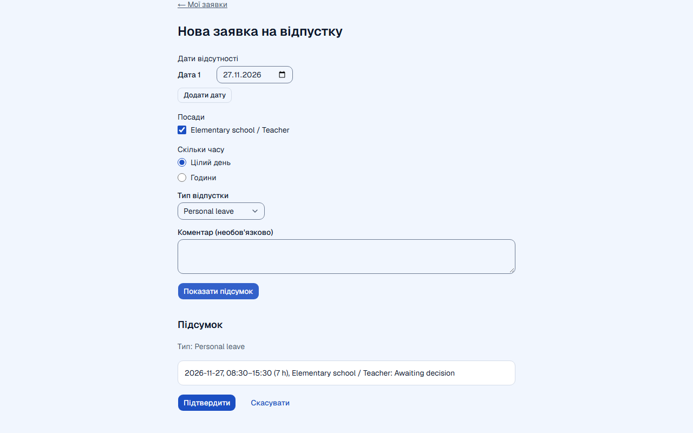

**Кроки:** ✔ Дано: manager1@example.test увійшов і не є адміністратором → ✔ Коли: manager1@example.test намагається закрити 2026-11-27 напряму, оминаючи сторінки порталу → ✔ Тоді: the school calendar is unchanged → ✔ Тоді: 2026-11-27 is still accepted in a new request

**Агент (claude-sonnet-5-5, NEEDS-HUMAN):** На першому кадрі видно «Шкільний календар», 2026–2027 і «No closed days in school year 2026–2027» (користувач manager1@example.test). На другому кадрі підсумок містить «2026-11-27, 08:30–15:30 (7 h)» без повідомлення про закриття, але особу, що подає заявку, не видно, тому вердикт NEEDS-HUMAN.

Haiku сказав NEEDS-HUMAN, тож розбір повторив Sonnet; рішення агента — за Sonnet.

**Агент бачить вади:**
- На кадрі frame-then-2.png не видно, хто увійшов (шапка порталу обрізана), тому не можна підтвердити, що заявку подає працівник, а не менеджер.

**Цитати агента, звірені зі сторінкою (aria):**
- «Шкільний календар» — є на сторінці
- «2026–2027» — є на сторінці
- «No closed days in school year 2026–2027» — є на сторінці
- «2026-11-27, 08:30–15:30 (7 h), Elementary school / Teacher: Awaiting decision» — є на сторінці

**Правило:** R3: перевірки пройшли, агент не погоджується — вирішує людина

**Відео:** `test-results/artifacts/calendar-працівник-і-кален-d0507-ться-2026-11-27-приймається-chromium/video.webm` · **траса:** `test-results/artifacts/calendar-працівник-і-кален-d0507-ться-2026-11-27-приймається-chromium/trace.zip` (не в git)

**Рішення PM:** ☐ приймаю · ☐ відхилення від вимог (issue «Відхилення від вимог: AC-CAL-13 — …») · @login: ____

## AC-CAL-14 — PASS

**Тест:** AC-CAL-14: відвідувач за прямим посиланням бачить сторінку входу без назв і дат закриттів

**Критерій** (requirements/04-school-calendar.md):

> AC-CAL-14: Given nobody is signed in. When a visitor opens the school calendar by a direct link. Then the visitor sees the sign-in page, and no closure names or dates are shown.

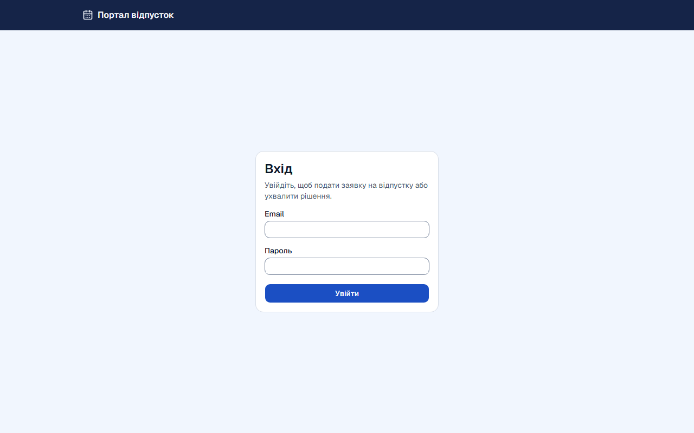

**Кроки:** ✔ Дано: ніхто не увійшов (у календарі є «Winter break») → ✔ Коли: відвідувач відкриває шкільний календар за прямим посиланням → ✔ Тоді: the visitor sees the sign-in page, and no closure names or dates are shown

**Агент (claude-haiku-5-5, PASS):** Кадр повний, читабельний, без завантаження: видно картку «Вхід» з полями «Email» і «Пароль» та кнопкою «Увійти». На кадрі немає жодної назви чи дати закриття (зокрема «Winter break» з journey.md не видно), календаря не показано. Друга частина оцінена як met за відсутністю таких написів на видимій сторінці; це негативна умова, тож цитата — видимий текст сторінки.

**Цитати агента, звірені зі сторінкою (aria):**
- «Вхід» — є на сторінці
- «Email» — є на сторінці
- «Пароль» — є на сторінці
- «Увійти» — є на сторінці
- «Вхід» — є на сторінці
- «Увійдіть, щоб подати заявку на відпустку або ухвалити рішення.» — є на сторінці

**Правило:** R6: перевірки, агент і цитати збігаються

**Відео:** `test-results/artifacts/calendar-відвідувач-без-вх-2f2c7-ду-без-назв-і-дат-закриттів-chromium/video.webm` · **траса:** `test-results/artifacts/calendar-відвідувач-без-вх-2f2c7-ду-без-назв-і-дат-закриттів-chromium/trace.zip` (не в git)

**Рішення PM:** ☐ приймаю · ☐ відхилення від вимог (issue «Відхилення від вимог: AC-CAL-14 — …») · @login: ____

## AC-CAL-15 — PASS

**Тест:** AC-CAL-15: у навчальному році без закриттів працівник бачить повідомлення

**Критерій** (requirements/04-school-calendar.md):

> AC-CAL-15: Given the school calendar has no closures in school year 2026–2027. When an employee opens the school calendar for school year 2026–2027. Then the employee sees the message "No closed days in school year 2026–2027".

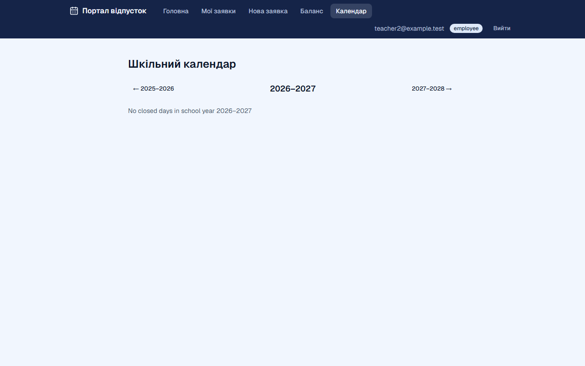

**Кроки:** ✔ Дано: шкільний календар не має закриттів у навчальному році 2026–2027 → ✔ Коли: працівник відкриває шкільний календар за навчальний рік 2026–2027 → ✔ Тоді: the employee sees the message "No closed days in school year 2026–2027"

**Агент (claude-haiku-5-5, PASS):** На кадрі /calendar видно заголовок «Шкільний календар», вибраний навчальний рік «2026–2027» і рядок «No closed days in school year 2026–2027». Тире в повідомленні візуально збігається з тире в критерії (довге, як у «2026–2027»); окремо не перевіряв символ посимвольно, але на кадрі відхилень не видно.

**Цитати агента, звірені зі сторінкою (aria):**
- «Шкільний календар» — є на сторінці
- «2026–2027» — є на сторінці
- «No closed days in school year 2026–2027» — є на сторінці

**Правило:** R6: перевірки, агент і цитати збігаються

**Відео:** `test-results/artifacts/calendar-працівник-і-кален-1a58d-ацівник-бачить-повідомлення-chromium/video.webm` · **траса:** `test-results/artifacts/calendar-працівник-і-кален-1a58d-ацівник-бачить-повідомлення-chromium/trace.zip` (не в git)

**Рішення PM:** ☐ приймаю · ☐ відхилення від вимог (issue «Відхилення від вимог: AC-CAL-15 — …») · @login: ____

## AC-DECIDE-14 — PASS

**Тест:** AC-DECIDE-14: менеджер без записів, що чекають рішення, бачить повідомлення про порожній список

**Критерій** (requirements/02-leave-decision.md):

> AC-DECIDE-14: Given the manager has 0 records with status "Awaiting decision". When the manager opens the "Awaiting decision" list. Then the manager sees the message "No records awaiting decision".

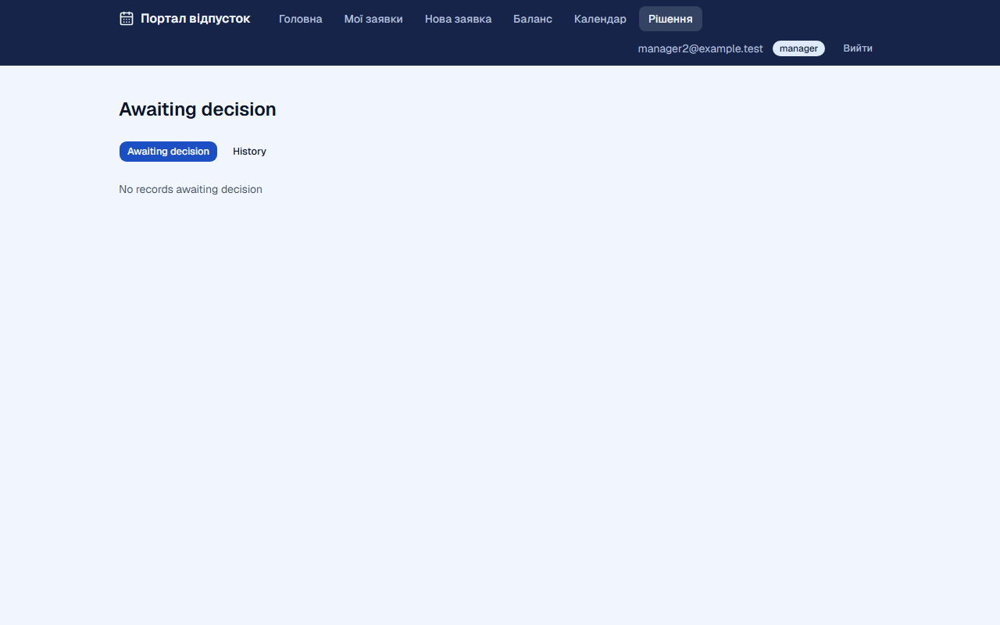

**Кроки:** ✔ Дано: менеджер має 0 записів зі статусом "Awaiting decision" → ✔ Коли: менеджер відкриває список "Awaiting decision" → ✔ Тоді: the manager sees the message "No records awaiting decision"

**Агент (claude-haiku-5-5, PASS):** На кадрі видно сторінку «Решення» з заголовком «Awaiting decision», активною вкладкою «Awaiting decision» і повідомленням «No records awaiting decision» під нею. Під повідомленням нічого немає, тобто записів у списку не видно. Текст повідомлення збігається з критерієм посимвольно.

**Цитати агента, звірені зі сторінкою (aria):**
- «Awaiting decision» — є на сторінці
- «No records awaiting decision» — є на сторінці
- «No records awaiting decision» — є на сторінці

**Правило:** R6: перевірки, агент і цитати збігаються

**Відео:** `test-results/artifacts/decisions-AC-DECIDE-14-мен-0b851-омлення-про-порожній-список-chromium/video.webm` · **траса:** `test-results/artifacts/decisions-AC-DECIDE-14-мен-0b851-омлення-про-порожній-список-chromium/trace.zip` (не в git)

**Рішення PM:** ☐ приймаю · ☐ відхилення від вимог (issue «Відхилення від вимог: AC-DECIDE-14 — …») · @login: ____

## AC-LEAVE-22 — PASS

**Тест:** AC-LEAVE-22: кінець відпустки 12:30 на початку наступного блоку дає 1 запис 09:00–12:30 на 3 год

**Критерій** (requirements/01-leave-request.md):

> AC-LEAVE-22: Given a position with the schedule blocks Tue 08:30–12:00 and 12:30–15:30. When the employee requests "Personal leave" on 2026-11-03 from 09:00 to 12:30. Then 1 record 2026-11-03 09:00–12:30 is created with a duration of 3 h (the gap 12:00–12:30 is not counted).

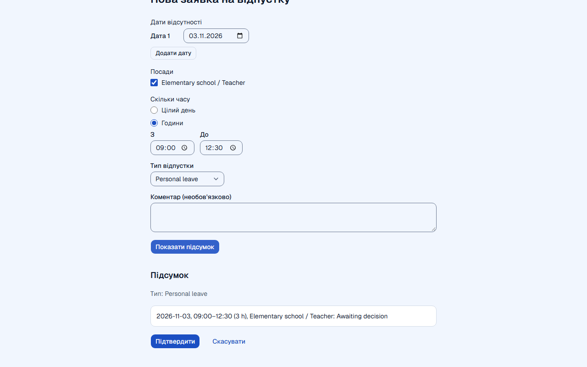
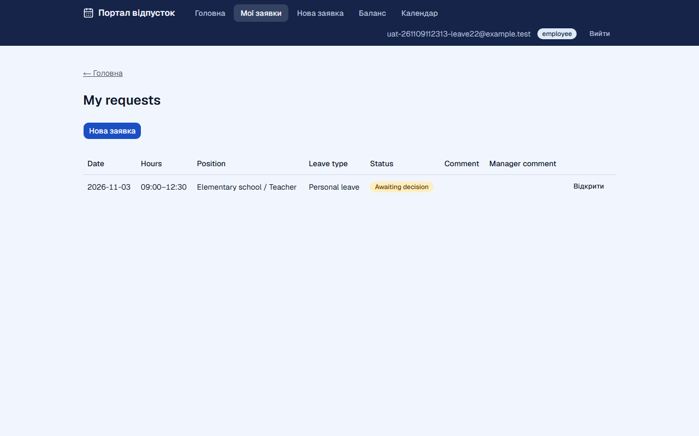

**Кроки:** ✔ Дано: посада з блоками розкладу Tue 08:30–12:00 і 12:30–15:30 → ✔ Коли: працівник просить "Personal leave" на 2026-11-03 з 09:00 до 12:30 → ✔ Тоді: the gap 12:00–12:30 is not counted: a duration of 3 h → ✔ Коли: працівник підтверджує підсумок → ✔ Тоді: 1 record 2026-11-03 09:00–12:30 is created

**Агент (claude-sonnet-5-5, PASS):** На першому кадрі видно блок «Підсумок» із рядком «2026-11-03, 09:00–12:30 (3 h)». На другому кадрі сторінка «My requests» містить рівно один рядок: 2026-11-03, 09:00–12:30, Personal leave.

Haiku сказав NEEDS-HUMAN, тож розбір повторив Sonnet; рішення агента — за Sonnet.

**Цитати агента, звірені зі сторінкою (aria):**
- «Підсумок» — є на сторінці
- «2026-11-03, 09:00–12:30 (3 h), Elementary school / Teacher: Awaiting decision» — є на сторінці
- «My requests» — є на сторінці
- «2026-11-03» — є на сторінці
- «09:00–12:30» — є на сторінці
- «Personal leave» — є на сторінці

**Правило:** R6: перевірки, агент і цитати збігаються

**Відео:** `test-results/artifacts/calendar-працівник-і-кален-29bc1--запис-09-00–12-30-на-3-год-chromium/video.webm` · **траса:** `test-results/artifacts/calendar-працівник-і-кален-29bc1--запис-09-00–12-30-на-3-год-chromium/trace.zip` (не в git)

**Рішення PM:** ☐ приймаю · ☐ відхилення від вимог (issue «Відхилення від вимог: AC-LEAVE-22 — …») · @login: ____

## Як читати підсумок

- **PASS** — автоматичні перевірки пройшли, агент-рецензент погодився з кадром, а кожну його цитату знайдено на сторінці.
- **FAIL** — впала автоматична перевірка. Агент цього не перекриває: невидимі вади (буфер обміну, база) він на кадрі не побачить.
- **NEEDS-HUMAN** — перевірки зелені, але агент не погодився або його цитати немає на сторінці. Часто це слабкий тест або розбіжність між текстом AC і тестом — питання до PM, а не обов'язково вада продукту.

Правила: R1: перевірка впала — FAIL завжди, агент не перекриває; R2: немає вердикту агента або кадру; R3: перевірки пройшли, агент не погоджується — вирішує людина; R4: цитати агента немає на сторінці (aria) — не підтверджено; R5: помилка сторінки або 5xx під час сценарію; R6: перевірки, агент і цитати збігаються.
