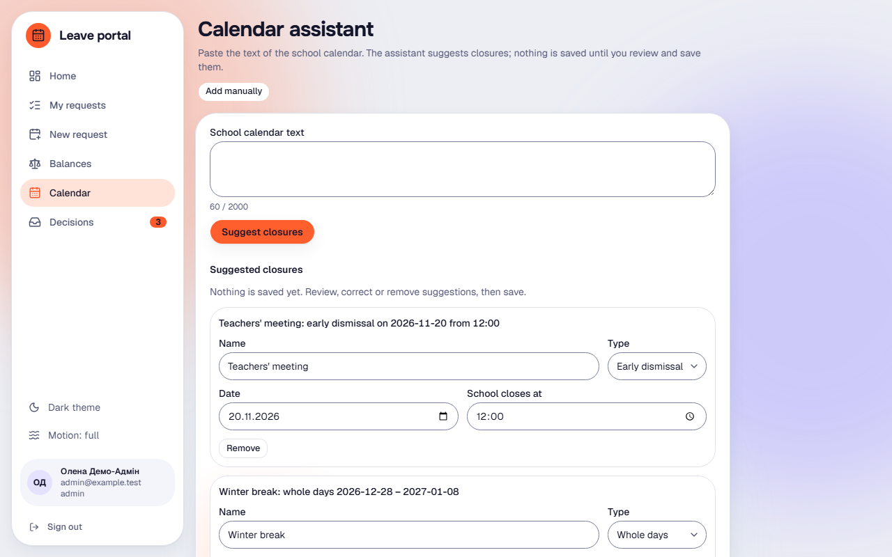
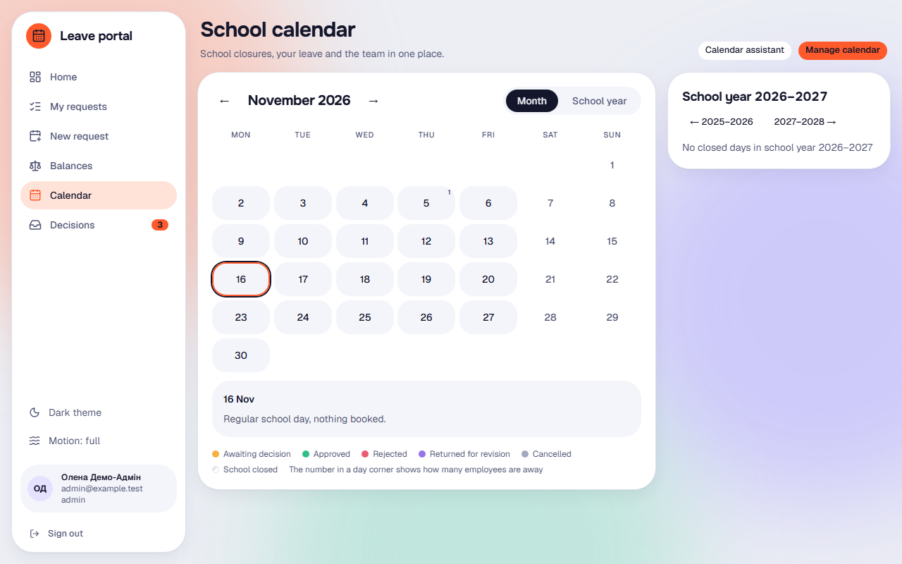
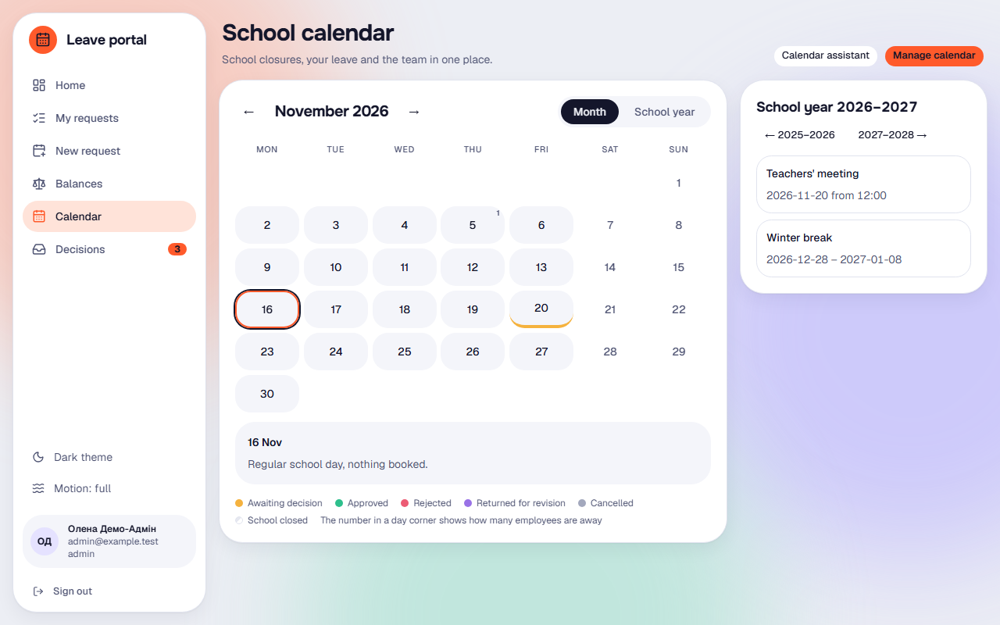
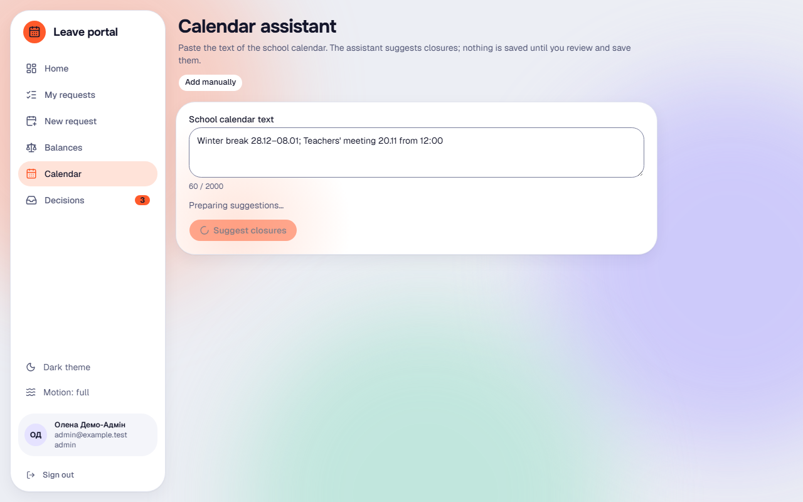
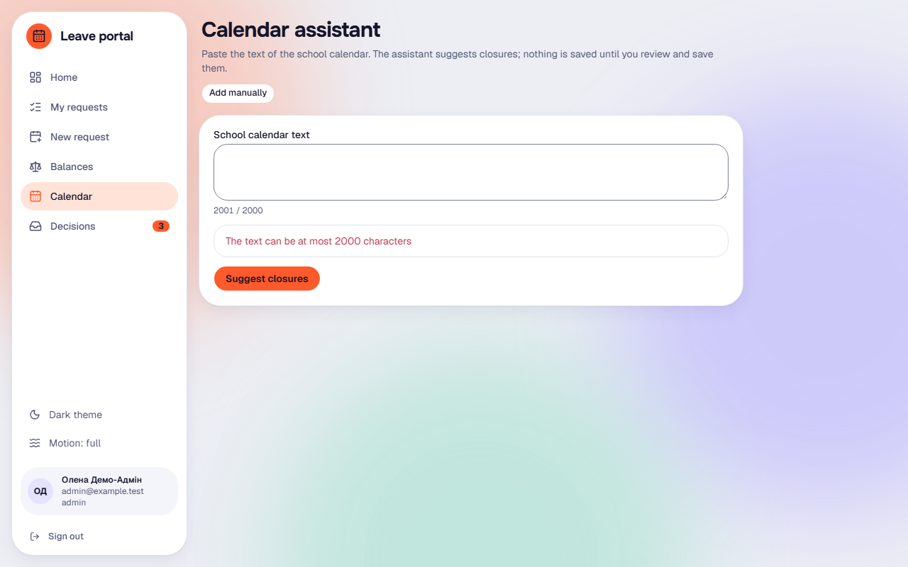
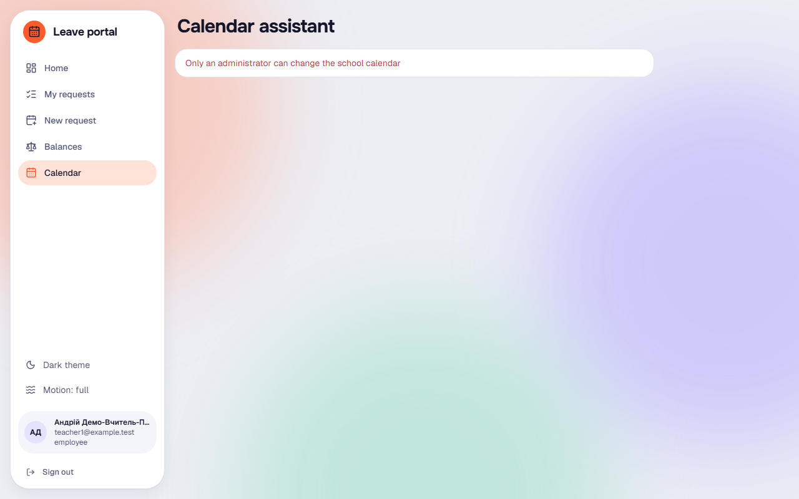

# Звіт UAT — 16.11.2026

- **Застосунок:** https://leave-portal-blush.vercel.app (/api/health: коміт `449975b`)
- **Код тестів:** `task/assistant-uat` @ `9e65e79`
- **Прогін:** 16.11.2026, 10:46 (Київ), Playwright 112.8 с; AC: 5 — PASS 5, FAIL 0, NEEDS-HUMAN 0
- **Рецензент:** `claude-haiku-5-5`; суперечки → `claude-sonnet-5-5`. Разом за розбір: $0.0108 (ціни API; за підпискою — у межах ліміту плану)
- **Прибирання:** синтетичних uat-*@example.test видалено 0, лишилось 0, їхніх рядків, що лишились: 0
- **Відео й траси:** не в git — `test-results/` локально або артефакт CI; трасу відкриває `npx playwright show-trace <trace.zip>`

| AC | Перевірки | Агент | Підсумок | Чому | Playwright | Розбір |
|---|---|---|---|---|---|---|
| AC-ASSIST-01 | пройшли | Haiku: PASS | **PASS** | R6: перевірки, агент і цитати збігаються | 17.8 с | $0.0028, 14.2 с |
| AC-ASSIST-02 | пройшли | Haiku: PASS | **PASS** | R6: перевірки, агент і цитати збігаються | 38.5 с | $0.0019, 10.5 с |
| AC-ASSIST-08 | пройшли | Haiku: PASS | **PASS** | R6: перевірки, агент і цитати збігаються | 10.9 с | $0.0018, 9.5 с |
| AC-ASSIST-10 | пройшли | Haiku: PASS | **PASS** | R6: перевірки, агент і цитати збігаються | 17.0 с | $0.0022, 10.7 с |
| AC-ASSIST-11 | пройшли | Haiku: PASS | **PASS** | R6: перевірки, агент і цитати збігаються | 6.8 с | $0.0020, 8.6 с |

## AC-ASSIST-01 — PASS

**Тест:** AC-ASSIST-01: два закриття з тексту пропонуються на перегляд, а шкільний календар лишається без закриттів

**Критерій** (requirements/05-calendar-assistant.md):

> AC-ASSIST-01: Given today is Friday 2026-11-13 and the school calendar has no closures. When the administrator asks the calendar assistant for suggestions for the text "Winter break 28.12–08.01; Teachers' meeting 20.11 from 12:00". Then the administrator sees 2 suggested closures — "Winter break" whole days 2026-12-28 – 2027-01-08 and "Teachers' meeting" early dismissal on 2026-11-20 from 12:00 — and the school calendar still has no closures.

**Кроки:** ✔ Дано: шкільний календар не має закриттів → ✔ Коли: адміністратор просить у помічника пропозиції для тексту «Winter break 28.12–08.01; Teachers' meeting 20.11 from 12:00» → ✔ Тоді: the administrator sees 2 suggested closures — "Winter break" whole days 2026-12-28 – 2027-01-08 and "Teachers' meeting" early dismissal on 2026-11-20 from 12:00 — and the school calendar still has no closures → ✔ Тоді: the school calendar still has no closures

**Агент (claude-haiku-5-5, PASS):** На кадрі 1 видно розділ «Suggested closures» з двома пропозиціями (Teachers' meeting з 12:00 на 20.11.2026 та Winter break з 28.12.2026 по 08.01.2027) і підказку «Nothing is saved yet». На кадрі 2 сторінка «School calendar» показує «School year 2026–2027» і «No closed days in school year 2026–2027», тобто закриттів не додано. Поле тексту на кадрі 1 порожнє, але це не частина «Тоді», тому на вердикт не впливає.

**Цитати агента, звірені зі сторінкою (aria):**
- «Suggested closures» — є на сторінці
- «Teachers' meeting: early dismissal on 2026-11-20 from 12:00» — є на сторінці
- «Winter break: whole days 2026-12-28 – 2027-01-08» — є на сторінці
- «Teachers' meeting: early dismissal on 2026-11-20 from 12:00» — є на сторінці
- «Winter break: whole days 2026-12-28 – 2027-01-08» — є на сторінці
- «Nothing is saved yet. Review, correct or remove suggestions, then save.» — є на сторінці
- «School calendar» — є на сторінці
- «School year 2026–2027» — є на сторінці
- «No closed days in school year 2026–2027» — є на сторінці

**Правило:** R6: перевірки, агент і цитати збігаються

**Відео:** `test-results/artifacts/assistant-адміністратор-AC-49564-дар-лишається-без-закриттів-chromium/video.webm` · **траса:** `test-results/artifacts/assistant-адміністратор-AC-49564-дар-лишається-без-закриттів-chromium/trace.zip` (не в git)

**Рішення PM:** ☐ приймаю · ☐ відхилення від вимог (issue «Відхилення від вимог: AC-ASSIST-01 — …») · @login: ____

## AC-ASSIST-02 — PASS

**Тест:** AC-ASSIST-02: збереження двох пропозицій без змін — календар показує обидва закриття

**Критерій** (requirements/05-calendar-assistant.md):

> AC-ASSIST-02: Given the 2 suggested closures from AC-ASSIST-01. When the administrator saves them without changes. Then the school calendar shows "Teachers' meeting" on 2026-11-20 from 12:00 and "Winter break" 2026-12-28 – 2027-01-08.

**Кроки:** ✔ Дано: 2 запропоновані закриття з AC-ASSIST-01 → ✔ Коли: адміністратор зберігає їх без змін → ✔ Тоді: the school calendar shows "Teachers' meeting" on 2026-11-20 from 12:00 and "Winter break" 2026-12-28 – 2027-01-08

**Агент (claude-haiku-5-5, PASS):** На кадрі сторінки School calendar у блоці «School year 2026–2027» видно два рядки: «Teachers' meeting» з «2026-11-20 from 12:00» і «Winter break» з «2026-12-28 – 2027-01-08». Текст читабельний і збігається з критерієм посимвольно. Частина «Дано/Коли» перевіряється не з кадрів, тому тут не оцінювалася.

**Цитати агента, звірені зі сторінкою (aria):**
- «School calendar» — є на сторінці
- «School year 2026–2027» — є на сторінці
- «Teachers' meeting» — є на сторінці
- «2026-11-20 from 12:00» — є на сторінці
- «Winter break» — є на сторінці
- «2026-12-28 – 2027-01-08» — є на сторінці

**Правило:** R6: перевірки, агент і цитати збігаються

**Відео:** `test-results/artifacts/assistant-адміністратор-AC-95f99-дар-показує-обидва-закриття-chromium/video.webm` · **траса:** `test-results/artifacts/assistant-адміністратор-AC-95f99-дар-показує-обидва-закриття-chromium/trace.zip` (не в git)

**Рішення PM:** ☐ приймаю · ☐ відхилення від вимог (issue «Відхилення від вимог: AC-ASSIST-02 — …») · @login: ____

## AC-ASSIST-08 — PASS

**Тест:** AC-ASSIST-08: поки помічник не відповів, адміністратор бачить «Preparing suggestions…» і не може запитати знову

**Критерій** (requirements/05-calendar-assistant.md):

> AC-ASSIST-08: Given the administrator has asked for suggestions and the calendar assistant has not answered yet. When the administrator looks at the calendar assistant. Then the administrator sees "Preparing suggestions…", and cannot ask for suggestions again until it answers.

**Кроки:** ✔ Дано: адміністратор попросив пропозиції, а помічник ще не відповів → ✔ Коли: адміністратор дивиться на помічника → ✔ Тоді: the administrator sees "Preparing suggestions…", and cannot ask for suggestions again until it answers

**Агент (claude-haiku-5-5, PASS):** На кадрі під полем тексту видно напис «Preparing suggestions…». Кнопка «Suggest closures» блідіша за звичайну, з рядком спінера, що вказує на недоступність; сам атрибут disabled з кадру не видно, тому стан виведено зі стилю. Частина про повторний запит до відповіді не є видимою частиною «Тоді» і тут не оцінювалась.

**Цитати агента, звірені зі сторінкою (aria):**
- «Preparing suggestions…» — є на сторінці
- «Suggest closures» — є на сторінці

**Правило:** R6: перевірки, агент і цитати збігаються

**Відео:** `test-results/artifacts/assistant-адміністратор-AC-948c7-…»-і-не-може-запитати-знову-chromium/video.webm` · **траса:** `test-results/artifacts/assistant-адміністратор-AC-948c7-…»-і-не-може-запитати-знову-chromium/trace.zip` (не в git)

**Рішення PM:** ☐ приймаю · ☐ відхилення від вимог (issue «Відхилення від вимог: AC-ASSIST-08 — …») · @login: ____

## AC-ASSIST-10 — PASS

**Тест:** AC-ASSIST-10: текст із 2001 символу — помічника не питаємо, адміністратор бачить повідомлення про 2000 символів

**Критерій** (requirements/05-calendar-assistant.md):

> AC-ASSIST-10: Given the administrator pastes a text of 2001 characters. When the administrator asks for suggestions. Then the calendar assistant is not asked, and the administrator sees the message "The text can be at most 2000 characters".

**Кроки:** ✔ Дано: адміністратор вставляє текст із 2001 символу → ✔ Коли: адміністратор просить пропозиції → ✔ Тоді: the calendar assistant is not asked, and the administrator sees the message "The text can be at most 2000 characters"

**Агент (claude-haiku-5-5, PASS):** На кадрі сторінки «Calendar assistant» видно форму з полем «School calendar text» і лічильником «2001 / 2000», під полем червоне повідомлення «The text can be at most 2000 characters», а кнопка «Suggest closures» є останнім елементом форми. Під формою нічого немає: пропозицій закриття на кадрі не видно. Частину «жодної пропозиції немає» підтверджую відсутністю контенту на кадрі; цитата з кнопки лише вказує на місце, де він мав би бути.

**Цитати агента, звірені зі сторінкою (aria):**
- «School calendar text» — є на сторінці
- «2001 / 2000» — є на сторінці
- «Suggest closures» — є на сторінці
- «The text can be at most 2000 characters» — є на сторінці
- «Suggest closures» — є на сторінці

**Правило:** R6: перевірки, агент і цитати збігаються

**Відео:** `test-results/artifacts/assistant-адміністратор-AC-02b88-ідомлення-про-2000-символів-chromium/video.webm` · **траса:** `test-results/artifacts/assistant-адміністратор-AC-02b88-ідомлення-про-2000-символів-chromium/trace.zip` (не в git)

**Рішення PM:** ☐ приймаю · ☐ відхилення від вимог (issue «Відхилення від вимог: AC-ASSIST-10 — …») · @login: ____

## AC-ASSIST-11 — PASS

**Тест:** AC-ASSIST-11: працівник за прямим посиланням бачить, що календар змінює лише адміністратор, і жодних пропозицій немає

**Критерій** (requirements/05-calendar-assistant.md):

> AC-ASSIST-11: Given teacher1@example.test is signed in and has only the employee role. When teacher1@example.test opens the calendar assistant by a direct link. Then teacher1@example.test sees the message "Only an administrator can change the school calendar", and no closures are suggested or saved.

**Кроки:** ✔ Дано: teacher1@example.test увійшов і має лише роль employee → ✔ Коли: teacher1@example.test відкриває помічника календаря за прямим посиланням → ✔ Тоді: teacher1@example.test sees the message "Only an administrator can change the school calendar", and no closures are suggested or saved

**Агент (claude-haiku-5-5, PASS):** На кадрі видно заголовок «Calendar assistant» і червоне повідомлення «Only an administrator can change the school calendar» у білій картці. Під повідомленням нічого немає: форми помічника з пропозиціями змін на сторінці не видно. Для третьої частини («форми немає») цитати немає, бо це відсутність елемента, тому quoted_text порожній.

**Цитати агента, звірені зі сторінкою (aria):**
- «Calendar assistant» — є на сторінці
- «Only an administrator can change the school calendar» — є на сторінці

**Правило:** R6: перевірки, агент і цитати збігаються

**Відео:** `test-results/artifacts/assistant-працівник-AC-ASS-8e9d3-р-і-жодних-пропозицій-немає-chromium/video.webm` · **траса:** `test-results/artifacts/assistant-працівник-AC-ASS-8e9d3-р-і-жодних-пропозицій-немає-chromium/trace.zip` (не в git)

**Рішення PM:** ☐ приймаю · ☐ відхилення від вимог (issue «Відхилення від вимог: AC-ASSIST-11 — …») · @login: ____

## Як читати підсумок

- **PASS** — автоматичні перевірки пройшли, агент-рецензент погодився з кадром, а кожну його цитату знайдено на сторінці.
- **FAIL** — впала автоматична перевірка. Агент цього не перекриває: невидимі вади (буфер обміну, база) він на кадрі не побачить.
- **NEEDS-HUMAN** — перевірки зелені, але агент не погодився або його цитати немає на сторінці. Часто це слабкий тест або розбіжність між текстом AC і тестом — питання до PM, а не обов'язково вада продукту.

Правила: R1: перевірка впала — FAIL завжди, агент не перекриває; R2: немає вердикту агента або кадру; R3: перевірки пройшли, агент не погоджується — вирішує людина; R4: цитати агента немає на сторінці (aria) — не підтверджено; R5: помилка сторінки або 5xx під час сценарію; R6: перевірки, агент і цитати збігаються.
